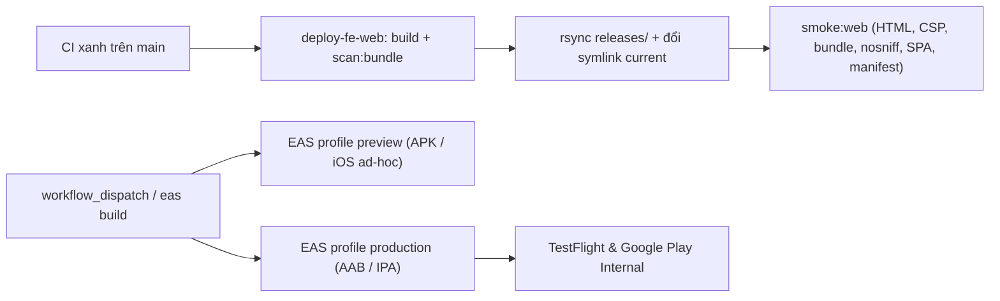

# Runbook — Build & phát hành thử nghiệm Frontend

> FE-S6-05. Bao gồm 3 ứng dụng: mobile (`apps/mobile`, Expo SDK 58), web admin (`apps/admin`, Vite static) và
> partner PWA (`apps/partner`, Vite static + `vite-plugin-pwa`). Hạ tầng staging chưa chốt (D5), web staging
> dùng chung máy Linux + SSH với [staging-deploy.md](staging-deploy.md).

## 1. Tổng quan

### Ứng dụng & môi trường

| App | Thư mục / ID | Local | Preview / Staging | Production (thử nghiệm) |
|---|---|---|---|---|
| Mobile (iOS/Android) | `apps/mobile` (`vn.tamgiao.app`) | Expo Dev (`localhost:3000`) | EAS `preview` (APK / iOS ad-hoc) → staging hoặc tunnel | EAS `production` (AAB / IPA) → Play Internal / TestFlight |
| Web admin | `apps/admin` | `vite` (`localhost:5173`) | Static build → `${STAGING_WEB_DIR}/admin/current` | Chờ chốt D5 |
| Partner PWA | `apps/partner` | `vite` (`localhost:5174`) | Static build → `${STAGING_WEB_DIR}/partner/current` | Chờ chốt D5 |

### Sơ đồ luồng phát hành



## 2. Chuẩn bị một lần (PO cung cấp)

| Hạng mục | Chi tiết | Người phụ trách | Trạng thái |
|---|---|---|---|
| Tài khoản Apple Developer | Cung cấp Team ID để EAS ký IPA & ad-hoc provisioning | PO | Chờ PO |
| App Store Connect | Tạo app bundle ID `vn.tamgiao.app`, lấy ASC App ID | PO | Chờ PO |
| APNs Key (iOS Push) | Tạo/quản lý tự động khi chạy `eas credentials` | DevOps / PO | Chờ tài khoản Apple |
| Google Play Console | Tạo app package `vn.tamgiao.app` + Service Account JSON (quyền Release manager) để submit | PO | Chờ PO |
| Firebase & FCM v1 (Android Push) | Tạo Firebase project cho `vn.tamgiao.app`, tải `google-services.json`; lấy FCM v1 Service Account Key và upload lên EAS qua `eas credentials` | PO / DevOps | Chờ PO |
| Tài khoản Expo & `EAS_PROJECT_ID` | Tạo org/project trên Expo, chạy `cd apps/mobile && eas init` để lấy `EAS_PROJECT_ID` (UUID) | DevOps / PO | Chờ PO |
| Robot token `EXPO_TOKEN` | Tạo Access Token (Robot) trên Expo dashboard, lưu vào GitHub Environment `mobile-release` (secret `EXPO_TOKEN`) | DevOps | Chờ tài khoản Expo |

## 3. Biến môi trường

### Mobile — EAS Environment variables (`preview` & `production`)

Khai báo trên Expo dashboard (hoặc `eas env:create`) theo từng environment `preview` và `production`, **không**
hardcode vào `apps/mobile/eas.json` hoặc GitHub workflow.

| Biến | Loại EAS | Bắt buộc | Mô tả |
|---|---|---|---|
| `EXPO_PUBLIC_API_URL` | Plaintext | Có (`NODE_ENV=production`) | URL HTTPS của API (vd `https://api.staging.example.vn`) |
| `EXPO_PUBLIC_WS_URL` | Plaintext | Có (`NODE_ENV=production`) | URL WSS của WebSocket chat (vd `wss://api.staging.example.vn/ws`) |
| `EXPO_PUBLIC_SENTRY_DSN` | Plaintext | Tuỳ chọn | DSN Sentry cho mobile; bỏ trống sẽ no-op (FE-S6-04) |
| `EAS_PROJECT_ID` | Plaintext | Có để bật push | UUID project Expo (`push-registrar.tsx` đọc từ `extra.eas.projectId`) |
| `EXPO_OWNER` | Plaintext | Tuỳ chọn | Tên owner/organization trên Expo nếu khác tài khoản mặc định |
| `GOOGLE_SERVICES_JSON` | File | Có (Android FCM v1) | File `google-services.json` do EAS mount khi build; `app.config.ts` truyền vào `android.googleServicesFile` |

### Web — GitHub Environment `staging` (`.github/workflows/deploy-fe-web.yml`)

| Loại | Tên | Ví dụ / Ghi chú |
|---|---|---|
| var | `STAGING_API_URL` | `https://api.staging.example.vn` (bắt buộc lúc `vite build`) |
| var | `STAGING_ADMIN_URL` | `https://admin.staging.example.vn` |
| var | `STAGING_PARTNER_URL` | `https://partner.staging.example.vn` |
| var | `STAGING_WEB_DIR` | `/srv/tamgiao-web` |
| var | `STAGING_WEB_SENTRY_DSN` | Tuỳ chọn; nếu có sẽ được thêm vào `connect-src` của CSP |
| secret | `STAGING_SSH_HOST`, `STAGING_SSH_USER`, `STAGING_SSH_KEY`, `STAGING_SSH_KNOWN_HOSTS` | Dùng chung với `deploy-staging.yml` |

> [!IMPORTANT]
> Biến `CORS_ORIGINS` trong `.env` của API staging **phải chứa** cả origin của `STAGING_ADMIN_URL` và
> `STAGING_PARTNER_URL` (cách nhau bằng dấu phẩy, không có `/` cuối), nếu không trình duyệt sẽ bị chặn CORS.

## 4. Build mobile

### Chạy tay tại máy (sau khi `eas login`)

```bash
cd apps/mobile
eas build --profile preview --platform android
```

### Chạy qua GitHub Actions

Vào **Actions → Build mobile (EAS) → Run workflow** (`.github/workflows/build-mobile.yml`), chọn:

- `profile`: `preview` hoặc `production`
- `platform`: `android`, `ios` hoặc `all`
- `submit`: `true` (chỉ có tác dụng khi `profile = production` để tự động nộp TestFlight / Play Internal)

### Cài bản `preview` trên máy test

- **Android:** mở link cài đặt hoặc tải file `.apk` từ trang build của EAS.
- **iOS (internal ad-hoc):** máy test phải được đăng ký UDID trước khi build. Chạy:
  ```bash
  cd apps/mobile && eas device:create
  ```
  Sau khi thêm thiết bị mới cần build lại bản `preview` để provisioning profile cập nhật UDID.

### Nộp TestFlight & Google Play Internal

```bash
cd apps/mobile
eas build --profile production --platform all --auto-submit
# Hoặc nộp lại một build đã có:
eas submit --profile production --platform all
```

Profile `production` nộp Android vào track `internal` với trạng thái `draft` (cần bấm rollout trên Play Console lần
đầu khi app còn là bản nháp), iOS đẩy thẳng lên TestFlight.

## 5. Quy trình tăng version

- **Version marketing (`version`):** khai báo duy nhất tại hằng `APP_VERSION` trong `apps/mobile/app.config.ts`
  (theo chuẩn semver `MAJOR.MINOR.PATCH`). Không đọc từ `package.json`, không bật `runtimeVersion` / `updates`
  (không dùng EAS Update).
- **Build number (iOS) & `versionCode` (Android):** EAS tự quản lý và tăng tự động ở mỗi lần build production nhờ
  `appVersionSource: "remote"` và `autoIncrement: true` trong `apps/mobile/eas.json`.
- **Phát hành phiên bản mới:**
  1. Tăng `APP_VERSION` trong `apps/mobile/app.config.ts`.
  2. Ghi changelog trong mô tả PR và merge vào `main`.
  3. Tạo tag git `mobile-v<version>` (vd `mobile-v0.1.0`) và chạy `build-mobile.yml` với `profile: production`.

## 6. Deploy web staging

### Luồng tự động (`.github/workflows/deploy-fe-web.yml`)

1. **build:** chạy khi `CI` xanh trên `main` (hoặc `workflow_dispatch`), build `@tamgiao/admin` và
   `@tamgiao/partner` với `VITE_API_URL` + `VITE_SENTRY_DSN`, sau đó chạy `scan:bundle` kiểm tra không lộ `/dev/`,
   URL dev hay secret mẫu.
2. **deploy:** tải artifact `fe-web-<sha>`, `rsync -az --delete` vào `${STAGING_WEB_DIR}/{admin,partner}/releases/<sha>/`,
   đổi symlink nguyên tử (`ln -sfn releases/<sha> current.tmp && mv -Tf current.tmp current`), chỉ giữ 5 release
   mới nhất.
3. **smoke:** chạy `pnpm --filter @tamgiao/tools smoke:web`.

### Cấu trúc thư mục trên máy staging

```text
/srv/tamgiao-web/
├── admin/
│   ├── current -> releases/<sha>
│   └── releases/<sha>/
└── partner/
    ├── current -> releases/<sha>
    └── releases/<sha>/
```

### Rollback

```bash
ssh <user>@<host>
cd /srv/tamgiao-web/admin && ln -sfn releases/<sha-trước> current.tmp && mv -Tf current.tmp current
cd /srv/tamgiao-web/partner && ln -sfn releases/<sha-trước> current.tmp && mv -Tf current.tmp current
```

### Ví dụ cấu hình Caddy (reverse proxy TLS)

Header khớp với file `dist/_headers` sinh ra từ `tools/security/web-security-headers.ts` (lưu ý: `admin` tắt
camera `camera=()`, còn `partner` bật `camera=(self)` để quét QR voucher; nếu bật `VITE_SENTRY_DSN` cần thêm
origin Sentry vào `connect-src`).

```caddyfile
admin.staging.example.vn {
  root * /srv/tamgiao-web/admin/current
  encode zstd gzip

  header {
    Content-Security-Policy "default-src 'self'; script-src 'self'; style-src 'self' https://fonts.googleapis.com; font-src 'self' https://fonts.gstatic.com; img-src 'self' data: blob: https:; connect-src 'self' https://api.staging.example.vn; media-src 'self' blob:; worker-src 'self'; manifest-src 'self'; object-src 'none'; base-uri 'self'; form-action 'self'; frame-src 'none'; frame-ancestors 'none'"
    Strict-Transport-Security "max-age=31536000; includeSubDomains"
    X-Content-Type-Options "nosniff"
    Referrer-Policy "no-referrer"
    X-Frame-Options "DENY"
    Cross-Origin-Opener-Policy "same-origin"
    Permissions-Policy "camera=(), microphone=(), geolocation=(), payment=(), usb=()"
  }

  @nocache path /index.html /sw.js
  header @nocache Cache-Control "no-cache"

  @assets path /assets/*
  header @assets Cache-Control "public, max-age=31536000, immutable"

  try_files {path} /index.html
  file_server
}

partner.staging.example.vn {
  root * /srv/tamgiao-web/partner/current
  encode zstd gzip

  header {
    Content-Security-Policy "default-src 'self'; script-src 'self'; style-src 'self' https://fonts.googleapis.com; font-src 'self' https://fonts.gstatic.com; img-src 'self' data: blob: https:; connect-src 'self' https://api.staging.example.vn; media-src 'self' blob:; worker-src 'self'; manifest-src 'self'; object-src 'none'; base-uri 'self'; form-action 'self'; frame-src 'none'; frame-ancestors 'none'"
    Strict-Transport-Security "max-age=31536000; includeSubDomains"
    X-Content-Type-Options "nosniff"
    Referrer-Policy "no-referrer"
    X-Frame-Options "DENY"
    Cross-Origin-Opener-Policy "same-origin"
    Permissions-Policy "camera=(self), microphone=(), geolocation=(), payment=(), usb=()"
  }

  @nocache path /index.html /sw.js
  header @nocache Cache-Control "no-cache"

  @assets path /assets/*
  header @assets Cache-Control "public, max-age=31536000, immutable"

  try_files {path} /index.html
  file_server
}
```

## 7. Smoke sau deploy web

Chạy thủ công để kiểm tra web staging:

```bash
SMOKE_ADMIN_URL=https://admin.staging.example.vn \
SMOKE_PARTNER_URL=https://partner.staging.example.vn \
SMOKE_API_URL=https://api.staging.example.vn \
  pnpm --filter @tamgiao/tools smoke:web
```

Script `tools/scripts/smoke-web.ts` kiểm tra lần lượt cho từng app:

1. `GET /` trả HTTP 200 và `content-type` chứa `text/html`.
2. HTML chứa `<meta http-equiv="Content-Security-Policy" ...>` có origin của `SMOKE_API_URL`.
3. Tất cả `<script type="module" src="...js">` trả HTTP 200 và ít nhất 1 bundle chứa origin của `SMOKE_API_URL`.
4. Response `GET /` có header `X-Content-Type-Options: nosniff`.
5. SPA fallback: `GET /__smoke_deep_link__` trả HTTP 200 và `text/html`.
6. Riêng `partner`: `GET /manifest.webmanifest` trả HTTP 200.

## 8. Kiểm tra nghiệm thu AC1

- **Khi đã có staging (D5):** cài bản `preview` lên máy thật, nhập SĐT test và đọc mã OTP từ log SMS giả trên
  container API (`[sms:dev] to=… text=…`, xem cách đọc ở `tools/scripts/smoke-staging.ts`), đăng nhập thành công
  và gọi được API người dùng.
- **Khi chưa có máy staging (D5 chưa chốt):** chạy BE local (`pnpm dev`), mở tunnel HTTPS trỏ về cổng 3000:
  ```bash
  cloudflared tunnel --url http://localhost:3000
  ```
  Đặt `EXPO_PUBLIC_API_URL=https://<tunnel-host>` và `EXPO_PUBLIC_WS_URL=wss://<tunnel-host>/ws` trong EAS
  environment `preview`, build lại bản `preview`, cài lên máy thật và lấy OTP từ stdout BE local để đăng nhập.

## 9. Việc còn chờ

- **Icon & splash từ designer:** hiện dùng icon mặc định Expo; plugin `expo-splash-screen` chỉ cấu hình màu nền
  `#f8f9ff` (token `surface` trong `packages/ui-tokens/src/tokens.ts`).
- **Phát hành công khai trên store:** chờ PO + pháp lý chốt chính sách quyền riêng tư, điều khoản sử dụng và
  nội dung liên quan (D1, D2, FE-D5).
- **Sentry sourcemap & native crash:** bổ sung upload sourcemap và native debug symbols khi có tài khoản Sentry
  và kích hoạt phát hành production chính thức.
